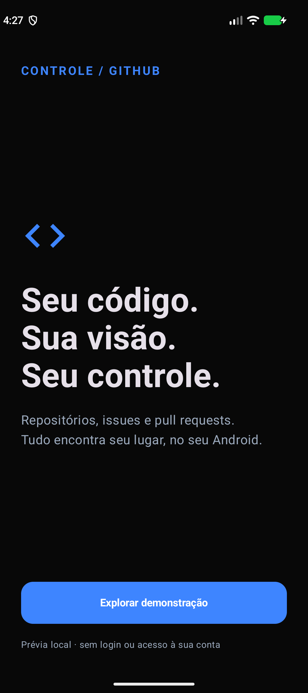
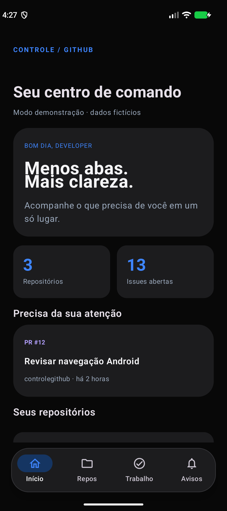
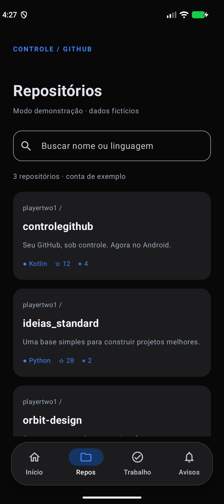
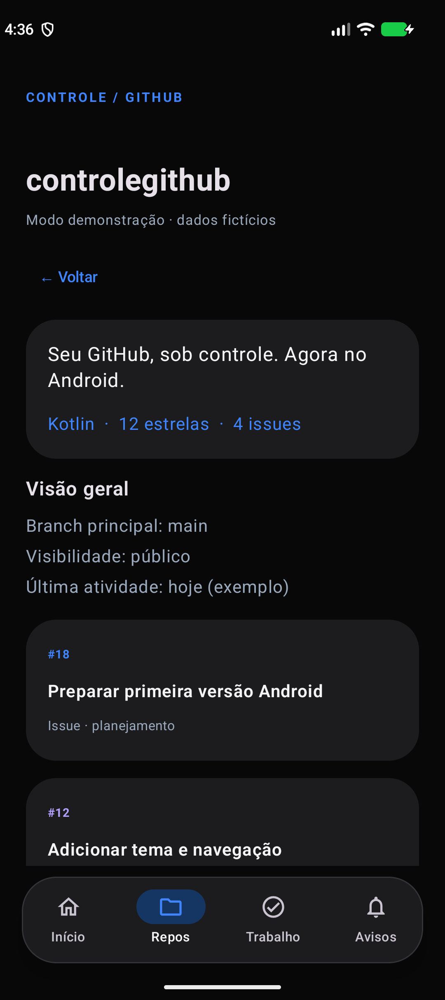
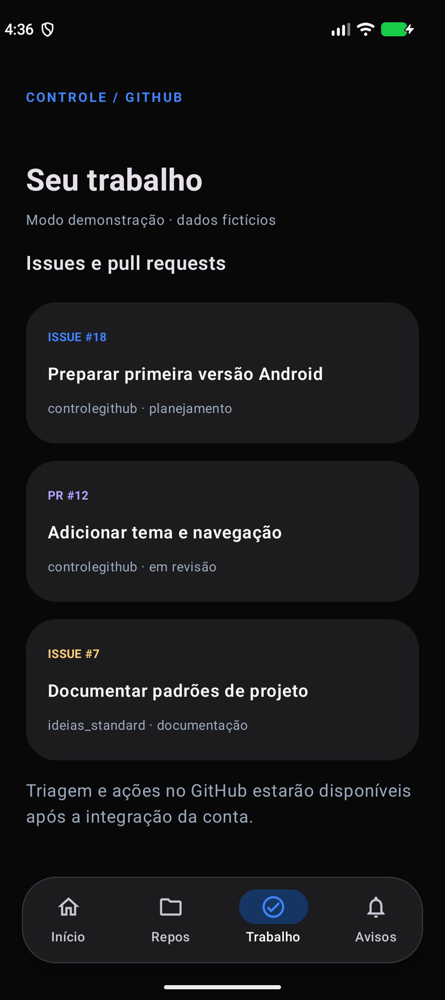
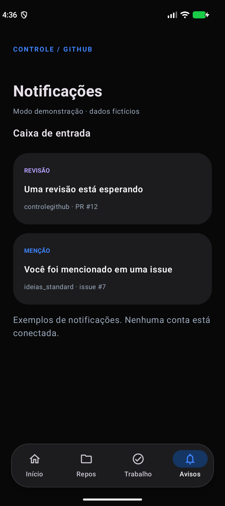

# ControleGitHub

[](https://github.com/playertwo1/controlegithub/releases)
[-green.svg)](https://developer.android.com)
[](LICENSE)
[](PRIVACY.md)

**Seu GitHub, sob controle.**
Um aplicativo Android nativo em Kotlin e Jetpack Compose, inspirado na proposta do [GitDeck](https://github.com/debba/gitdeck), com interface própria Material 3 e navegação ágil inspirada na One UI em português do Brasil.

---

## Fase atual do roadmap (C22.1–C24.1)

- **Leitura Markdown:** renderização de Markdown e tabelas GFM com tratamento seguro de links e conteúdo externo.
- **Edição Markdown:** editor com formatação, abas Escrever/Prévia e rascunhos locais por conta e item.
- **Navegação de código:** navegação por pastas e arquivos com breadcrumb, números de linha e destaque local; arquivos binários ou acima de 1 MB exibem um aviso.

Essas entregas compõem a versão publicada 2.0.0.

---

## 🚀 Versão 2.0.0 Oficial

O ControleGitHub chega à versão **2.0.0**, construída sobre uma arquitetura estritamente **local-first**:
- Conexão direta e exclusiva entre seu celular e a API oficial do GitHub (`https://api.github.com`).
- Sem servidores intermediários, sem telemetria e sem coleta oculta de dados.
- Criptografia em hardware (`AndroidKeyStore` AES-256-GCM) para credenciais de sessão.
- Backup em nuvem desabilitado por segurança (`android:allowBackup="false"`).

---

## 📥 Download e Instalação

Baixe o pacote oficial assinado na aba de [Releases do GitHub](https://github.com/playertwo1/controlegithub/releases):

| Artefato | Versão | Arquivo | Checksum SHA-256 |
| :--- | :---: | :---: | :--- |
| **APK de Produção** | `2.0.0` (101) | `app-release.apk` | `64A3549593E6EC7CC10D70F6E49B56FD3FBA6E4BB65FF11015CA1F46575AF8D8` |

**Atenção:** a v2.0.0 usa uma nova chave de assinatura. Ela não atualiza a v1.0.0 diretamente. Para instalar, desinstale a versão anterior; o Android apagará os dados locais do aplicativo.

### Verificação de Integridade

No Windows (PowerShell):
```powershell
Get-FileHash -Algorithm SHA256 app-release.apk
```

No Linux ou macOS:
```bash
sha256sum app-release.apk
```

O hash deve ser idêntico a:
```text
64A3549593E6EC7CC10D70F6E49B56FD3FBA6E4BB65FF11015CA1F46575AF8D8
```

---

## ✨ Funcionalidades Principais

- **Autenticação Segura via Device Flow:** Login rápido pelo navegador oficial sem digitar senhas no app.
- **Painel Executivo & Resumo Diário:** Métricas consolidadas em tempo real e síntese das últimas 24 horas exportável em Markdown.
- **Repositórios:** Listagem rápida, busca instantânea, ordenação e filtros dinâmicos.
- **Demandas (Issues):** Visualização completa, criação com proteção anti-duplo clique, edição de título/corpo, comentários, labels e fechar/reabrir.
- **Revisão de Pull Requests:** Inspeção de arquivos alterados, comentários e submissão formal de pareceres (*Aprovar*, *Comentar*, *Solicitar alterações*).
- **Quadro Kanban Local (4 Colunas):** Organize issues pessoalmente em *A fazer*, *Em andamento*, *Em revisão* e *Concluído* sem alterar o repositório remoto no GitHub.
- **Notificações Integradas:** Leitura de avisos por repositório com marcação rápida de leitura.
- **GitHub Actions (CI/CD):** Acompanhamento de execuções de workflows, jobs e visualizador otimizado de logs de compilação.
- **Leitura e edição Markdown:** Prévia de conteúdo, tabelas GFM, formatação e rascunhos locais.
- **Navegador de código:** Acesso à árvore do repositório, arquivos de texto com linhas numeradas e destaque local.
- **Modo Offline & Cache SQLite:** Consultas salvas localmente com revalidação condicional via HTTP ETag (`304 Not Modified`) e selo de data/hora.
- **Sincronização em Segundo Plano:** Agendador nativo com `JobScheduler` e alertas locais configuráveis no canal `controlegithub_alerts`.
- **Acessibilidade e Temas:** Suporte integral aos temas Claro, Escuro e Sistema, alto contraste WCAG AA e compatibilidade com TalkBack.

---

## 📱 Capturas de Tela

| Entrada | Painel | Repositórios |
|---|---|---|
|  |  |  |

| Detalhes | Trabalho & Demandas | Notificações |
|---|---|---|
|  |  |  |

---

## 🛠️ Compilação e Desenvolvimento

1. Clone o repositório:
   ```bash
   git clone https://github.com/playertwo1/controlegithub.git
   cd controlegithub
   ```
2. Abra a pasta no **Android Studio** ou compile via linha de comando com JDK 17 e Android SDK (API 36):
   ```bash
   # Compilar versão de depuração (Debug)
   ./gradlew assembleDebug

   # Executar testes unitários
   ./gradlew testDebugUnitTest

   # Checagem de Lint
   ./gradlew lintDebug
   ```
3. Para compilar a versão de release, mantenha o keystore e os quatro valores de assinatura em `.secrets/` (diretório ignorado pelo Git) e execute:
   ```bash
   ./gradlew assembleRelease
   ```

---

## 📚 Documentação do Projeto

- [Notas de Lançamento 2.0.0](docs/RELEASE_NOTES_v2.0.0.md)
- [Notas de Lançamento 1.0.0](docs/RELEASE_NOTES_v1.0.0.md)
- [Manual do Usuário](docs/MANUAL_DO_USUARIO.md)
- [Guia de Operação e Suporte](docs/OPERACAO_E_SUPORTE.md)
- [Instruções de Release e Assinatura](docs/RELEASE.md)
- [Changelog Completo](CHANGELOG.md)
- [Roadmap Operacional](ROADMAP.md)
- [Estado Atual e Evidências](PROJECT_STATE.md)
- [Política de Privacidade](PRIVACY.md)
- [Política de Segurança](SECURITY.md)
- [Licença MIT](LICENSE)
