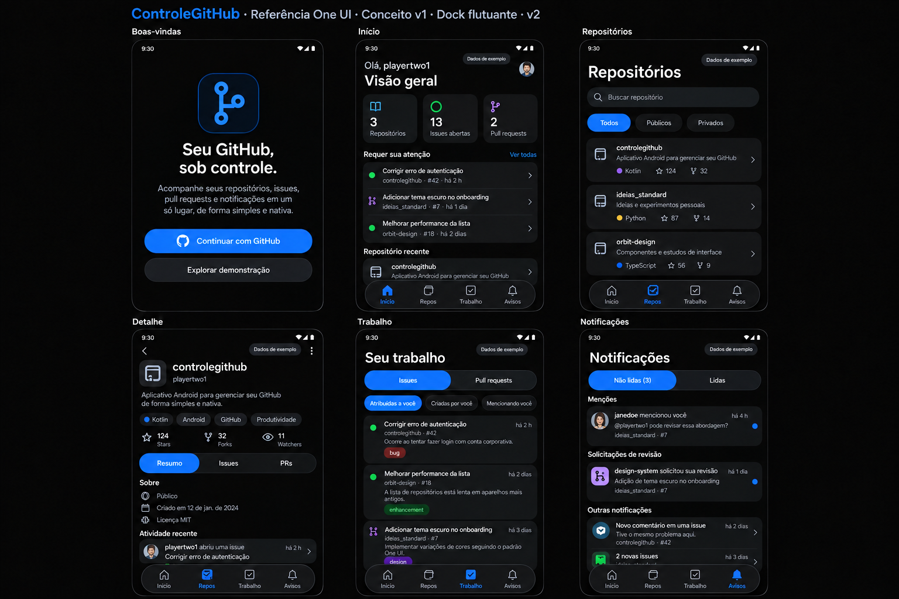

# ControleGitHub

Seu GitHub, sob controle. Um aplicativo Android nativo em Kotlin e Jetpack
Compose, inspirado na proposta do [GitDeck](https://github.com/debba/gitdeck) e
com interface própria para celular.

**Estado atual:** autenticação GitHub e alguns fluxos de leitura usam dados reais
da conta conectada. As áreas ainda não integradas são identificadas no app; o
modo de demonstração usa dados fictícios rotulados como demonstração. O produto
continua em desenvolvimento e ainda não oferece operações de escrita no GitHub.
O estado detalhado e as limitações verificadas estão em
[STATE.md](STATE.md).

## O que funciona hoje

- Autorização por Device Flow, restauração de sessão cifrada no aparelho e logout.
- Perfil da conta, lista de repositórios e busca/filtros locais dos itens carregados.
- Detalhe do repositório, painel da conta e lista/filtros/detalhe de issues em leitura.
- Pull requests em leitura: lista, detalhe, comentários, reviews, arquivos, diff e checks.
- GitHub Actions em leitura: workflows, execuções, jobs e logs (C10 aceito; veja
  [evidência C10.2](docs/evidence/C10.2.md)).
- Favoritos locais de repositórios e preferência de tema (Sistema/Claro/Escuro).
- Modo de demonstração para áreas ainda não conectadas, sem apresentar amostras
  como dados da conta.

## Design

[Catálogo das 36 telas e estados conceituais](docs/design/README.md): inspiração
One UI, tema escuro e menu inferior flutuante. As imagens mostram o produto
planejado; não comprovam a implementação das telas.



## Capturas

As imagens abaixo documentam capturas do baseline visual inicial no emulador.
Elas antecedem as integrações reais e mostram dados fictícios; consulte o estado
atual em [STATE.md](STATE.md).

| Entrada | Painel | Repositórios |
|---|---|---|
|  |  |  |

| Detalhe | Trabalho | Notificações |
|---|---|---|
|  |  |  |

## Como rodar

1. Abra a pasta no Android Studio e aguarde a sincronização Gradle.
2. Use JDK 17, SDK Android 36 e um dispositivo Android 8.0 (API 26) ou superior.
3. Configure o SDK no Android Studio ou em `local.properties` (não versionado).
4. Para habilitar o login local, configure `GITHUB_OAUTH_CLIENT_ID` conforme
   [docs/AUTH.md](docs/AUTH.md). Sem essa propriedade, o app informa que a
   autorização está indisponível; a demonstração permanece acessível.
5. Execute o módulo `app` (ou `./gradlew installDebug`).

## Como verificar

```sh
python scripts/check_plan.py
./gradlew assembleDebug testDebugUnitTest lintDebug
# Com emulador ou dispositivo conectado:
./gradlew connectedDebugAndroidTest
```

Windows: use `.\gradlew.bat`.
APK local: `app/build/outputs/apk/debug/app-debug.apk`.

## Roadmap e documentos

O [roadmap](ROADMAP.md) define os 21 checkpoints e cinco marcos. O
[backlog](plan/tasks.json) contém as 42 tarefas e seus estados canônicos; rode
`python scripts/check_plan.py` antes de selecionar trabalho. O
[protocolo de execução](docs/EXECUTION.md) define como continuar uma tarefa; cada
entrega READY tem um contrato em `plan/contracts/`. O
[estado atual](STATE.md) e as evidências em `docs/evidence/` registram o
que foi verificado e o que segue pendente. Consulte também as
[decisões de arquitetura](docs/ARCHITECTURE.md), o [contrato visual](docs/DESIGN.md),
o [guia OAuth](docs/AUTH.md) e a [verificação histórica da fundação](docs/VERIFICATION.md).

Visão, MVP e fora de escopo em [PROJECT.md](PROJECT.md); histórico em
[CHANGELOG.md](CHANGELOG.md). A estrutura segue o
[Ideias Standard](https://github.com/playertwo1/ideias_standard) v1.2.0; veja
[origem e adaptações](docs/STANDARD_ADOPTION.md). Histórico (não editar): `docs/archive/`.

## Contribuir

Abra uma issue descrevendo o problema, altere o mínimo necessário, execute os
checks e envie um PR com evidência. Nunca inclua credenciais nas capturas ou logs.
Veja [CONTRIBUTING.md](CONTRIBUTING.md) e [SECURITY.md](SECURITY.md).
teste do appp
teste 2 do app
