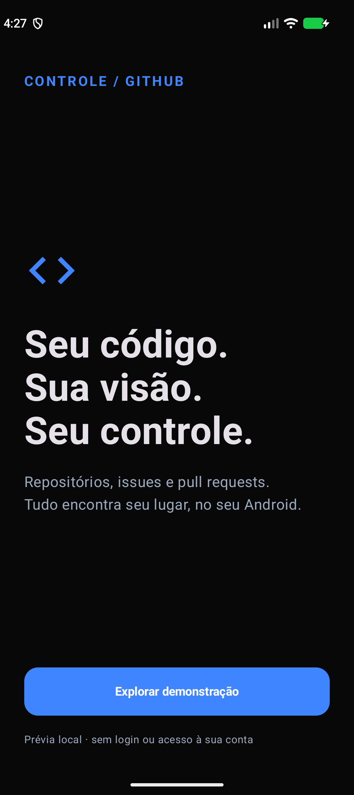
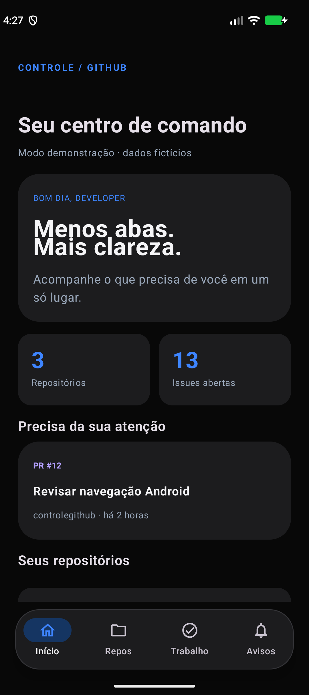
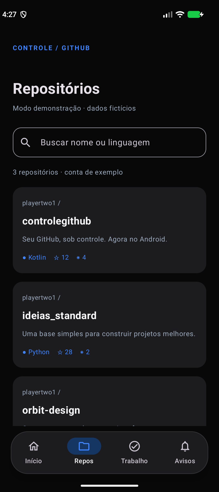
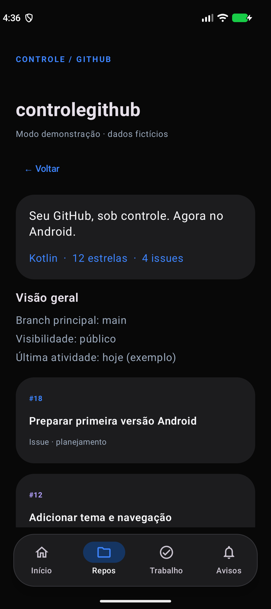
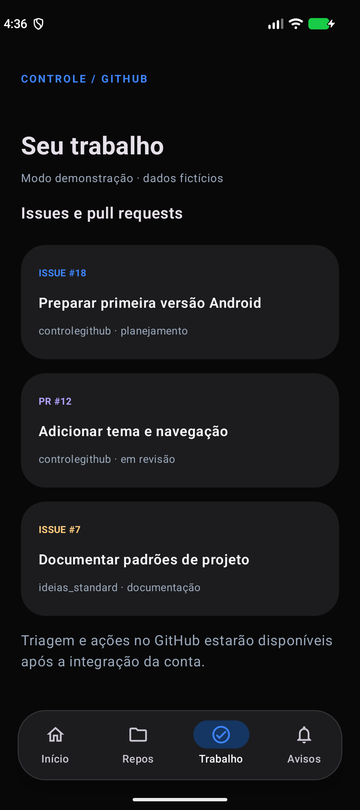
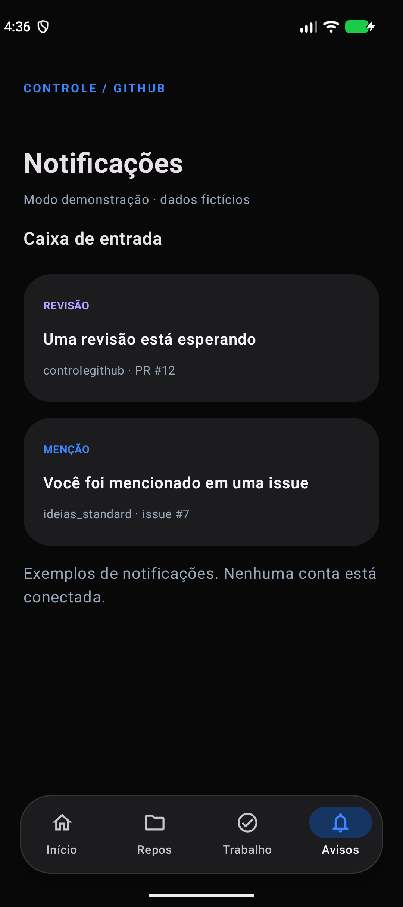
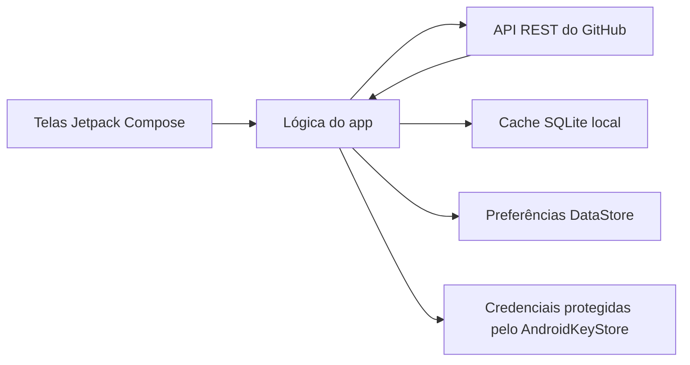

<p align="center">
  
</p>

<p align="center">
  <a href="https://github.com/playertwo1/controlegithub/releases/latest"></a>
  <a href="https://developer.android.com"></a>
  <a href="LICENSE"></a>
</p>

O **ControleGitHub** é um cliente Android nativo para acompanhar seus repositórios, issues, pull requests, notificações e GitHub Actions em um só lugar. A interface em português é feita com Kotlin e Jetpack Compose; o aplicativo conversa diretamente com a API do GitHub, sem servidor intermediário próprio.

[Baixar a versão 2.6.1](https://github.com/playertwo1/controlegithub/releases/tag/v2.6.1) · [Manual do usuário](docs/MANUAL_DO_USUARIO.md) · [Política de privacidade](PRIVACY.md)

## Conteúdo

- [Funcionalidades](#funcionalidades)
- [Capturas de tela](#capturas-de-tela)
- [Privacidade e armazenamento](#privacidade-e-armazenamento)
- [Instalar o aplicativo](#instalar-o-aplicativo)
- [Compilar e desenvolver](#compilar-e-desenvolver)
- [Estrutura do projeto](#estrutura-do-projeto)
- [Documentação](#documentação)
- [Licença](#licença)

## Funcionalidades

- **Painel e resumo diário:** acompanhe repositórios, issues e notificações; copie o resumo de atividade em Markdown.
- **Repositórios:** busque seus repositórios e explore repositórios públicos; veja destaques do dia, da semana ou do mês, consulte detalhes, código, releases, estrelas e Watch.
- **Issues e pull requests:** filtre e pagine itens, crie e edite issues, comente, altere labels e estado, revise PRs e inspecione arquivos alterados.
- **Kanban pessoal:** organize issues em quatro colunas locais, sem alterar os dados do repositório no GitHub.
- **Notificações e GitHub Actions:** acompanhe avisos, execuções de workflows, jobs e logs.
- **Markdown e código:** leia Markdown, tabelas e HTML comum em READMEs; toque em imagens para abrir a prévia dentro do app. Edite com prévia e rascunhos locais; navegue por pastas e arquivos de texto.
- **Trabalho offline:** consulte dados em cache quando disponíveis; ações que escrevem no GitHub exigem conexão.
- **Atalhos no launcher:** abra diretamente Resumo Diário, Repositórios, Demandas ou Avisos.

## Capturas de tela

As imagens abaixo mostram a interface em **modo de demonstração com dados fictícios**. Os números e itens visíveis não representam uma conta GitHub real.

| Entrada | Painel de demonstração | Repositórios |
|---|---|---|
|  |  |  |

| Detalhe | Issues e pull requests | Notificações |
|---|---|---|
|  |  |  |

## Privacidade e armazenamento

- O login usa **OAuth Device Flow** do GitHub; o app não recebe sua senha.
- Requisições são feitas diretamente para `api.github.com`; não há backend próprio, telemetria ou analytics.
- Credenciais são protegidas com `AndroidKeyStore` e criptografia AES-256-GCM.
- O backup do Android fica desativado para os dados do app. Ao sair da conta, credenciais, cache e dados locais associados são apagados.
- O modo offline usa cache local isolado por conta. Dados em cache podem ficar desatualizados; operações de escrita precisam de internet.

Consulte a [Política de Privacidade](PRIVACY.md) para os detalhes sobre dados e armazenamento.

## Instalar o aplicativo

1. Baixe `app-release.apk` na [release v2.6.1](https://github.com/playertwo1/controlegithub/releases/tag/v2.6.1).
2. (Opcional) Baixe também `SHA256SUMS.txt` e confira o SHA-256 do APK.
3. Abra o APK no Android e confirme a instalação. Se necessário, permita a instalação para a origem usada.

Requer **Android 8.0 (API 26) ou superior**. O SHA-256 da versão 2.6.1 é:

```text
C4B809DB5A8251A0A440A743A6871BDCE99549F86437DB0C631C6885EEA69599
```

Atualizações entre versões **2.x** preservam os dados locais. Para migrar diretamente de uma versão **1.x**, é necessário desinstalá-la; isso apaga os dados locais daquela instalação. Consulte [todas as releases](https://github.com/playertwo1/controlegithub/releases).

## Compilar e desenvolver

### Requisitos

- Android Studio com suporte ao Android Gradle Plugin usado pelo projeto.
- JDK 17 e Android SDK Platform 36.
- Um emulador ou dispositivo Android 8.0+ para executar o app.

Clone o projeto e abra-o no Android Studio, ou compile pelo terminal:

```bash
git clone https://github.com/playertwo1/controlegithub.git
cd controlegithub
./gradlew assembleDebug
./gradlew testDebugUnitTest
./gradlew lintDebug
```

No Windows PowerShell, use `.\gradlew.bat` no lugar de `./gradlew`.

O login exige um **OAuth App do GitHub** configurado. Passe seu client ID ao Gradle:

```bash
./gradlew assembleDebug -PGITHUB_OAUTH_CLIENT_ID=seu-client-id
```

Para compilar uma release assinada, configure a chave de produção local em `.secrets/signing.properties` ou pelas propriedades/variáveis Gradle descritas no [Guia de Release](docs/RELEASE.md). A chave e as credenciais não devem ser commitadas.

## Estrutura do projeto

```text
app/src/main/java/com/playertwo/controlegithub/  # app Compose, telas, clientes GitHub e armazenamento local
app/src/main/res/                                # recursos Android, incluindo o ícone adaptativo
app/src/test/                                    # testes unitários e validações da release
app/src/androidTest/                             # testes instrumentados no Android
docs/                                            # manual, políticas, evidências e notas de versão
plan/tasks.json                                  # backlog operacional do projeto
```

O fluxo de dados principal é local ao aplicativo e usa a API oficial do GitHub:



## Documentação

- [Manual do usuário](docs/MANUAL_DO_USUARIO.md)
- [Notas da versão 2.6.1](docs/RELEASE_NOTES_v2.6.1.md)
- [Guia de release, assinatura e distribuição](docs/RELEASE.md)
- [Política de privacidade](PRIVACY.md)
- [Política de segurança](SECURITY.md)
- [Guia de operação e suporte](docs/OPERACAO_E_SUPORTE.md)
- [Roadmap](ROADMAP.md)
- [Estado do projeto e evidências](PROJECT_STATE.md)
- [Changelog](CHANGELOG.md)

## Licença

Distribuído sob a licença [MIT](LICENSE).
