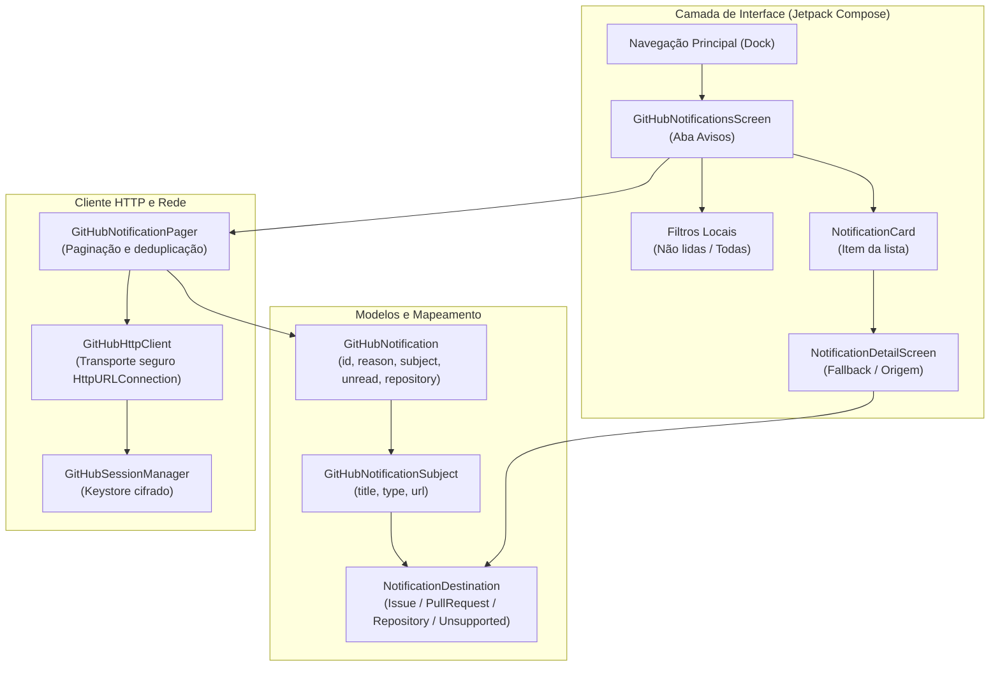

# Arquitetura inicial

## Decisões

Android nativo em Kotlin e Jetpack Compose, módulo único `app`, minSdk 26.
AGP 9.1.1, Gradle 9.3.1, JDK 17 e plugin Compose 2.2.10 seguem a matriz
[oficial de compatibilidade](https://developer.android.com/build/releases/agp-9-1-0-release-notes).
As versões são fixadas para reprodução, sem dependências dinâmicas.

O módulo único `app` contém a navegação Compose, telas e integração Android.
`DemoData` alimenta somente a demonstração identificada como tal. Fluxos reais
usam cliente REST GitHub, armazenamento cifrado da sessão protegido pelo Android
Keystore e estado de tela separado conforme necessário. A implementação continua
deliberadamente sem backend próprio, banco de cache ou framework de injeção de
dependências.

## Integração atual e limites

Autenticação usa o [Device Flow documentado pelo GitHub](https://docs.github.com/en/apps/oauth-apps/building-oauth-apps/authorizing-oauth-apps#device-flow).
O Client ID é público; client secret não é embutido no aplicativo. O token fica
protegido no dispositivo e não é enviado a um backend próprio. Perfil,
repositórios, detalhe/README, issues/comentários, PRs/arquivos/diffs/checks e
Actions/jobs/logs têm integrações de leitura. Favoritos são locais, por conta.
O estado por tela, as limitações e as verificações estão
em [PROJECT_STATE.md](../PROJECT_STATE.md) e `docs/evidence/`.

Escrita no GitHub e cache persistente permanecem fora do estado implementado;
dependências e decisões futuras seguem o roadmap. C09.1 (caixa de notificações)
está concluído e comprovado com OAuth Device Flow real e testes instrumentados;
`GET /notifications` foi validado empiricamente retornando 200 OK com token OAuth
clássico (escopos `repo` e `notifications`), resolvendo a divergência histórica de
documentação. C09.2 (marcar como lida) é a próxima etapa de mutação.

## Notificações e Autenticação (C09.1)

A caixa de notificações integra a aba autenticada "Avisos" com a API do GitHub (`GET /notifications`). A autenticação utiliza o token OAuth App obtido via Device Flow com escopos `read:user repo notifications`.

### Fluxo de Autenticação e Consulta de Notificações

```mermaid
sequenceDiagram
    autonumber
    actor User as Usuário
    participant UI as ControleGitHub UI (Avisos)
    participant Client as GitHubHttpClient
    participant API as GitHub REST API (/notifications)
    participant Origin as Telas de Origem (Issue / PR / Repo)

    User->>UI: Abre aba "Avisos"
    UI->>Client: GET /notifications?all=true&per_page=50
    Note over Client,API: Header Authorization: Bearer &lt;oauth_token&gt;
    Client->>API: HTTP GET /notifications
    alt 200 OK (Lista retornada)
        API-->>Client: JSON com notificações (threads)
        Client-->>UI: Coleção deduplicada e tipada
        UI->>User: Exibe lista com filtros locais (Todas / Não lidas)
    else 403 Forbidden (Escopo insuficiente)
        API-->>Client: 403 Forbidden
        Client-->>UI: Erro tipado (OAuth rejeitado)
        UI->>User: Exibe aviso explicativo; sessão mantida ativa
    else 401 / 429 / Rede
        API-->>Client: Erro HTTP / timeout
        Client-->>UI: Estado de erro específico
        UI->>User: Mensagem amigável com opção de tentar novamente
    end

    opt Navegação para Origem
        User->>UI: Clica em card de notificação
        UI->>UI: Valida subject URL contra domínios confiáveis
        alt Origem suportada (Issue / PR / Repo)
            UI->>Origin: Abre detalhe da Issue / PR / Repo
            User->>Origin: Clica em "Voltar aos avisos"
            Origin-->>UI: Retorna à lista com posição e filtros preservados
        else Origem desconhecida / não suportada
            UI->>User: Exibe card de detalhe com fallback textual acessível
        end
    end
```

### Arquitetura de Componentes da Caixa de Notificações



## Relação com GitDeck

Inspiração funcional, sem copiar código, identidade ou imagens. O GitDeck usa
frontend web e servidor Node; este projeto começa com implementação Android própria.

## Referência OpenHub e propostas futuras

Referência de comportamentos, sem importação de fonte/assets/traduções. OpenHub
usa Java/MVP e componentes antigos; não se propõe migrar a base Kotlin/Compose
nem o transporte HttpURLConnection. Sua GPL-3.0 e atribuições precisam ser
avaliadas antes de qualquer incorporação de material protegido.

O [detalhamento](superpowers/specs/2026-10-17-openhub-aproveitamento-design.md)
orientou o cache privado SQLite nativo, isolamento por conta, retenção LRU,
restauração de sessão offline e revalidação HTTP condicional com ETag/304,
concluídos com sucesso em C11.1 e C11.2 (fechando o Milestone 2).

## Cache Local e Revalidação Condicional HTTP (C11)

Concluído em C11.1 e C11.2, o subsistema de cache offline e revalidação condicional fornece resiliência e economia de largura de banda para todas as telas de leitura do aplicativo (`Repositories`, `Issues`, `PullRequests` e `Notifications`):

### Características de Implementação
1. **Armazenamento Privado:** SQLite nativo via `SQLiteGitHubCacheStore` (`controlegithub_cache.db`), sem bibliotecas externas (zero novas dependências).
2. **Isolamento de Contas:** Chave primária composta `(account_login, resource_key)` com normalização do login em minúsculas.
3. **Segurança de Dados Sensíveis:** `isCacheableResource` filtra e bloqueia o armazenamento de credenciais, tokens OAuth, códigos temporários e logs de Actions.
4. **Revalidação Condicional:** Suporte a cabeçalhos `If-None-Match` e `ETag` via `HttpURLConnection`. Resposta `304 Not Modified` atualiza o timestamp e o ETag sem retransmitir o payload, desativando a badge de offline.
5. **Deduplicação e Atualização:** Resposta `200 OK` atualiza o banco e a memória atomicamente sem duplicações de IDs.
6. **Preservação de Conteúdo no Erro:** Falha de rede ou erro 5xx durante refresh preserva a lista já renderizada na tela e oferece botão de "Tentar novamente".
7. **Limpeza no Logout:** Descarte imediato e atômico do cache da conta desconectada.

### Diagrama de Sequência de Refresh Condicional

```mermaid
sequenceDiagram
    autonumber
    actor User as Desenvolvedor
    participant UI as Telas Compose (Repos/Issues/PRs/Avisos)
    participant Pager as GitHubPaginator
    participant Cache as SQLiteGitHubCacheStore
    participant Client as GitHubHttpClient
    participant API as GitHub REST API

    User->>UI: Dispara Refresh (Swipe / Botão)
    UI->>Pager: refresh()
    Pager->>Cache: get(account, resourceKey)
    alt Cache existe com ETag
        Cache-->>Pager: CachedResponse(items, etag="\"abc123\"")
        Pager->>Client: get(url, token, ifNoneMatch="\"abc123\"")
    else Sem cache ou sem ETag
        Pager->>Client: get(url, token, ifNoneMatch=null)
    end
    Client->>API: GET /repos/... (If-None-Match: "abc123")
    alt HTTP 304 Not Modified
        API-->>Client: 304 Not Modified
        Client-->>Pager: Success(304, empty body, etag)
        Pager->>Cache: updateTimestamp(account, resourceKey, revalidatedAt, ttl, etag)
        Pager-->>UI: Emite itens em cache atualizados (isOfflineCache=false)
        UI->>UI: Preserva lista, remove badge offline, fecha indicador de refresh
    else HTTP 200 OK
        API-->>Client: 200 OK (novos dados, novo ETag)
        Client-->>Pager: Success(200, json, newEtag)
        Pager->>Cache: put(account, resourceKey, json, newEtag)
        Pager-->>UI: Emite nova lista sem duplicar IDs (isOfflineCache=false)
        UI->>UI: Renderiza novos dados, atualiza lista
    else Erro de Rede ou 5xx
        API-->>Client: Network Failure / Timeout / 500
        Client-->>Pager: Failure(NETWORK / SERVER)
        Pager-->>UI: Emite RefreshError(error)
        UI->>UI: PRESERVA itens visíveis na tela! Exibe Aviso de erro + Botão "Tentar novamente"
    else Rate Limit (403/429)
        API-->>Client: 403 / 429 com x-ratelimit-reset
        Client-->>Pager: Failure(RATE_LIMIT)
        Pager-->>UI: Emite RateLimitError
        UI->>UI: Exibe tempo de espera; bloqueia novas requisições em loop
    end
```

Markdown formatado e prévia local segura são propostas; o conteúdo atual é
inerte. Roteador reutilizável deve preservar destinos existentes, validar URLs
e usar fallback sem encaminhar credencial. Não introduzir WebView ativa,
dependência nova, Android App Links ou escrita offline incidentalmente.
Decisões finais e aceites pertencem aos contratos refinados, não a esta seção.
